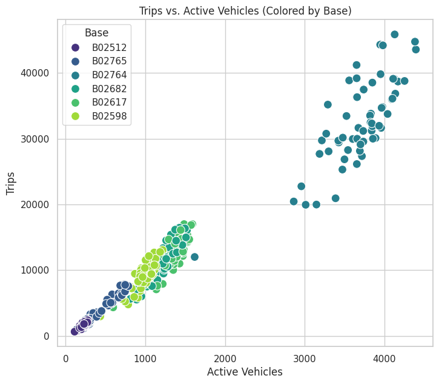
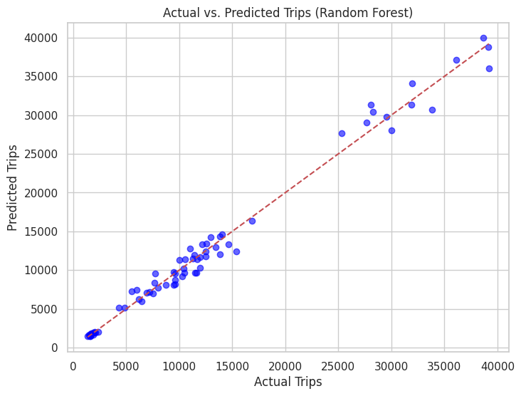
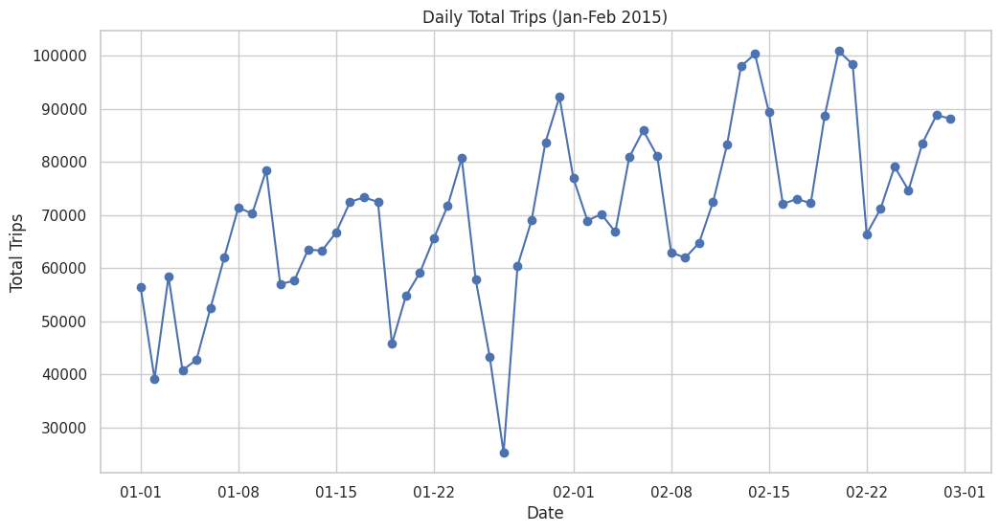
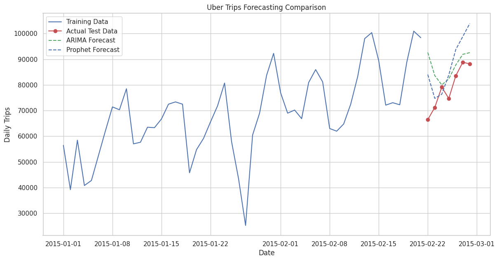
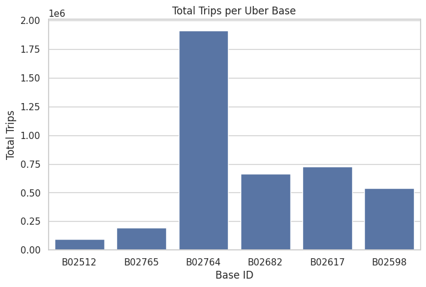

# 🚗 Uber Trip Analysis & Forecasting

An end-to-end data analytics project focused on understanding Uber trip patterns, analyzing vehicle utilization, and forecasting trip demand using Python, machine learning, and time-series analysis.

**Created by:** Vaibhav Borkar

## 📌 Project Overview

I worked on this project to explore Uber trip data from January and February 2015 and understand how trip demand changes over time.

The project focuses on identifying weekly travel patterns, analyzing the relationship between active vehicles and trips, comparing dispatching base performance, and building forecasting models to predict future trip volumes.

My goal was to turn raw data into meaningful insights that could help improve fleet planning, resource allocation, and operational decision-making.

## 🎯 Project Objectives

- Analyze daily and weekly trip patterns.
- Understand the relationship between active vehicles and trip volume.
- Compare trip volumes across different Uber dispatching bases.
- Perform exploratory data analysis (EDA) and data visualization.
- Build a Random Forest regression model to predict trip volume.
- Compare ARIMA and Prophet forecasting models.
- Identify actionable insights for better fleet management.

## 📂 Dataset

The analysis uses the `Uber-Jan-Feb-FOIL.csv` dataset.

- **Time period:** January–February 2015
- **Total records:** 354
- **Dispatching bases:** 6
- **Key variables:** Date, dispatching base, active vehicles, and trips

### Dataset Columns

| Column | Description |
|---|---|
| `dispatching_base_number` | Identifier for the Uber dispatching base |
| `date` | Date of the recorded activity |
| `active_vehicles` | Number of active vehicles |
| `trips` | Number of trips recorded |

## 🛠️ Tools & Technologies

- **Python** — Data analysis and model development
- **Pandas & NumPy** — Data cleaning and manipulation
- **Matplotlib & Seaborn** — Data visualization
- **Scikit-learn** — Random Forest regression and model evaluation
- **Statsmodels** — ARIMA forecasting and time-series decomposition
- **Prophet** — Time-series forecasting
- **Google Colab / Jupyter Notebook** — Development environment
- **GitHub** — Project documentation and version control

## 🔄 Project Workflow

### 1. Data Preprocessing

- Loaded the dataset using Pandas.
- Examined data types and descriptive statistics.
- Converted the date column into datetime format.
- Extracted month, day, day of the week, and weekend features.
- Calculated trips per active vehicle for further analysis.

### 2. Exploratory Data Analysis (EDA)

Explored trip patterns through charts and statistical analysis, including:

- Trips by day of the week.
- Average trips across weekdays.
- Active vehicles versus trips.
- Total trips per dispatching base.
- Correlation between key variables.
- Daily trip trends and time-series decomposition.

### 3. Machine Learning

Developed a Random Forest Regressor to estimate trip volume and evaluated its predictions using Mean Squared Error (MSE) and the R² score.

### 4. Time-Series Forecasting

Implemented two forecasting models:

- **ARIMA:** Forecasts future trip volumes using historical time-series patterns.
- **Prophet:** Models trends and seasonal patterns to forecast trip demand.

Both models were evaluated using Root Mean Squared Error (RMSE).

## 📈 Visual Insights

### 1. Trips vs. Active Vehicles

This chart shows a strong positive relationship between the number of active vehicles and recorded trips across dispatching bases.



### 2. Actual vs. Predicted Trips

The Random Forest model's predictions are compared with actual trip counts. The points generally follow the diagonal reference line, indicating that the model fits the evaluated observations closely.



### 3. Daily Trip Trends

Daily trip volumes fluctuated throughout January and February 2015, with several noticeable peaks and dips. These patterns highlight the importance of understanding changing demand.



### 4. Forecasting Comparison: ARIMA vs. Prophet

This chart compares the actual test-period trip volumes with forecasts generated by ARIMA and Prophet. It helps illustrate how the two models perform against observed demand.



### 5. Total Trips per Uber Base

Trip volumes varied significantly across the six dispatching bases. Base B02764 recorded the highest total trip volume in this dataset, making base-level analysis important for resource planning.



## 🔍 Key Findings

- **Weekly patterns:** Thursday, Friday, and Saturday showed higher average trip volumes in the analysis.
- **Vehicle availability:** Active vehicles and trips had a strong positive correlation of approximately **0.98**.
- **Base-level differences:** B02764 recorded substantially more trips than the other dispatching bases.
- **Changing demand:** Daily trip volumes fluctuated considerably during the two-month period.
- **Forecasting performance:** Prophet achieved a lower RMSE than ARIMA in the reported test evaluation.

## 🤖 Model Performance

The following results were obtained in the notebook:

| Model | Evaluation Metric | Result |
|---|---|---:|
| Random Forest Regressor | MSE | 1,513,379.90 |
| Random Forest Regressor | R² Score | 0.99 |
| ARIMA | RMSE | 11,616.64 |
| Prophet | RMSE | 11,131.81 |

**What these results mean:**

- The Random Forest model achieved an R² score of 0.99 on the reported evaluation.
- Prophet recorded a lower RMSE than ARIMA, indicating better predictive performance on the evaluated test period.
- The forecasting results provide a useful starting point for exploring demand prediction and fleet planning.

These are results from the current experiment, not a guarantee of future performance. Further validation and model tuning would help assess how well the models generalize to unseen data.

## 💡 Business Recommendations

Based on the analysis, I identified several practical recommendations:

- Allocate more vehicles during periods of higher demand.
- Use historical trip patterns to improve weekly fleet scheduling.
- Monitor active vehicle availability alongside trip volume.
- Analyze dispatching bases individually to identify resource requirements.
- Incorporate more historical data to improve forecasting reliability.
- Continue evaluating and refining predictive models as new data becomes available.

## 📁 Repository Structure

```text
Uber-Trip-Analysis/
│
├── images/
│   ├── trips-vs-vehicles.png
│   ├── actual-vs-predicted.png
│   ├── daily-trips.png
│   ├── forecasting-comparison.png
│   └── trips-by-base.png
│
├── Uber-Jan-Feb-FOIL.csv
├── Uber.ipynb - Colab.pdf
├── Uber Analysis.pptx
└── README.md
```

**Files included:**

- `Uber-Jan-Feb-FOIL.csv` — Dataset used for analysis.
- `Uber.ipynb - Colab.pdf` — Exported notebook showing the analysis, code, visualizations, and model results.
- `Uber Analysis.pptx` — Presentation summarizing the methodology and key findings.
- `images/` — Charts used in this README.
- `README.md` — Project documentation.

## ▶️ How to Run the Project

1. Clone or download this repository.
2. Open [Google Colab](https://colab.research.google.com/).
3. Upload the CSV dataset.
4. Upload the original `.ipynb` notebook if you have it, or recreate the notebook using the code documented in the PDF.
5. Install the required libraries.
6. Run the notebook cells to reproduce the analysis and forecasting experiments.

### Install Dependencies

```bash
pip install pandas numpy matplotlib seaborn scikit-learn statsmodels prophet
```

## 🚀 Future Improvements

- Tune model parameters and compare additional forecasting approaches.
- Use time-based train/test splits and rolling validation.
- Add more historical trip data to better understand long-term patterns.
- Explore additional features that may explain changes in trip demand.
- Build an interactive dashboard for exploring trip patterns and forecasts.
- Evaluate model performance across individual dispatching bases.

## 📚 What I Learned

Working on this project helped me gain practical experience with data preprocessing, exploratory data analysis, feature engineering, data visualization, regression models, and time-series forecasting.

It also helped me understand how to communicate analytical findings and translate them into practical business recommendations.

## 👨‍💻 About Me

I'm Vaibhav Borkar, an aspiring data analyst interested in using data to solve real-world business problems.

I enjoy exploring datasets, identifying trends, building analytical models, and presenting insights in a clear and meaningful way. I'm continuously developing my skills through hands-on projects involving Python, data analytics, and machine learning.

---

**Thank you for checking out my project!**

If you have suggestions or feedback, feel free to explore the repository and share your thoughts.
